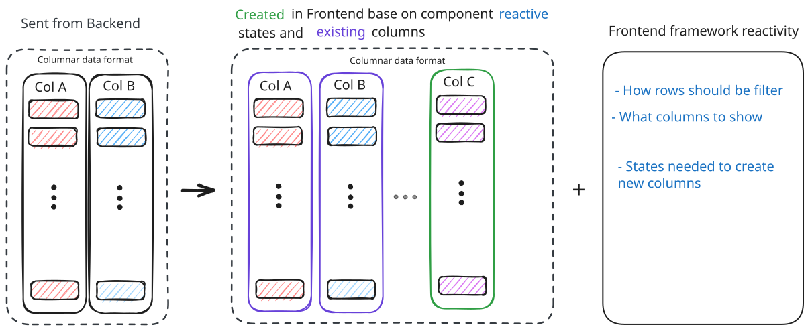

# arrow-frame-ts

<kbd>
I don't know what I am doing. I don't know what I want with this repo. I am tired of AI tech news, AI podcasts, AI agile "ted talks", AI coding, AI code reviews, and VSCode AI agent updates. Tired of how the industry keeps telling us  devs how we will not exist soon.
</kbd>

 

<kbd>I don’t want AI to think for me; I want to think; so I will tinker.</kbd>

### Status

<kbd>Experimenting.</kbd>

### Problem space

